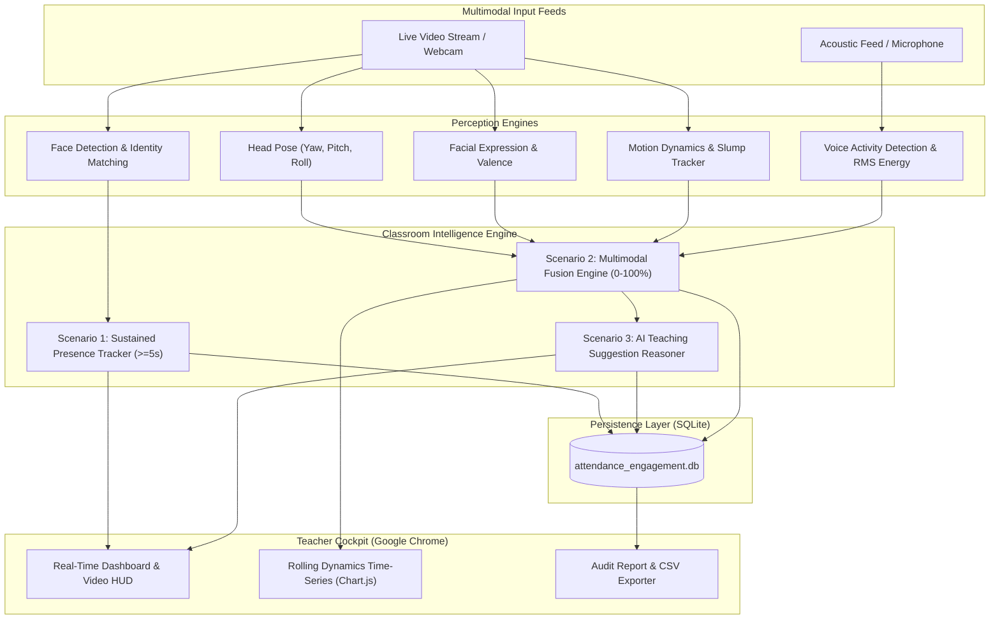

# Multimodal Attendance & Engagement Agent
### AI-Powered, Privacy-Preserving Classroom Intelligence System

[](https://www.python.org/)
[](https://fastapi.tiangolo.com/)
[](https://websockets.readthedocs.io/)
[](LICENSE)

---

## 📌 Project Links for Mentor Review & Showcase
- **Direct Working Live Demo Link**: [https://kishan-techno.github.io/Multimodal-agent/](https://kishan-techno.github.io/Multimodal-agent/)
- **GitHub Repository**: [https://github.com/Kishan-techno/Multimodal-agent](https://github.com/Kishan-techno/Multimodal-agent)
- **Direct Video Showcase**: [https://kishan-techno.github.io/Multimodal-agent/](https://kishan-techno.github.io/Multimodal-agent/) *(Interactive web video simulator & live demonstration)*

---

## 🌟 Executive Summary & Problem Context
In educational institutions and corporate training environments, attendance tracking remains largely manual or limited to basic biometric/RFID checkpoints that fail to capture meaningful learner engagement, participation context, or session efficacy. 

**The Multimodal Attendance & Engagement Agent** moves beyond binary presence detection. It fuses computer vision, audio signal processing, and agent-based reasoning to continuously monitor classroom dynamics, verify attendance via a robust **sustained presence model**, and deliver real-time, non-intrusive **AI pedagogical decision support** to educators. Designed to operate completely offline on edge hardware, the system preserves student privacy while providing actionable intelligence.

---

## 🏗️ System Architecture & Workflow



---

## 🎯 Implementation of Core Scenarios

### 📍 Scenario 1: Automated Attendance Tracking (Sustained Presence)
- **Problem**: Traditional face recognition falsely marks students present if someone glances past the camera for a single frame.
- **Solution**: Evaluates temporal continuity through a windowed accumulator.
  - Requires **$\ge 5.0$ seconds of continuous sustained presence** before status transitions to `PRESENT`.
  - Presence between $2.0\text{s} - 5.0\text{s}$ is categorized as `PARTIAL`.
  - Fleeting appearances ($< 2.0\text{s}$) remain `ABSENT`.
- Automatically logs `first_seen`, `last_seen`, `sustained_duration_seconds`, and `verification_confidence`.

### 📍 Scenario 2: Engagement and Session Dynamics Analysis
Multimodal signal fusion combines visual and acoustic indicators into a composite score:

$$E_{\text{score}} = w_v \cdot \text{Attention}_{\text{visual}} + w_f \cdot \text{Valence}_{\text{facial}} + w_a \cdot \text{Activity}_{\text{acoustic}} + w_m \cdot \text{Dynamics}_{\text{motion}}$$

- **Visual Attention**: Yaw and Pitch penalties detect looking down at smartphones or turning away from the lecture.
- **Acoustic Signal**: Voice Activity Detection (VAD) monitors discussion frequency vs. teacher monologue and classroom noise.
- **Motion Dynamics**: Optical dynamics detect fatigue slump or restlessness/fidgeting.
- **Time-Series Dynamics**: Rolling 60-second window detects interaction peaks and attention drops.

### 📍 Scenario 3: AI-Driven Teaching Suggestions
An intelligent decision-support agent continuously analyzes rolling metrics and issues actionable pedagogical recommendations:
- **Attention Drop Intervention**: Triggers when visual focus drops $< 40\%$ (e.g. *"Attention Drop: Launch a 30-second live quiz or show an illustrative diagram"*).
- **Interactive Discussion Prompt**: Triggers after prolonged acoustic silence ($> 18$s) to encourage small-group breakouts.
- **Fatigue / Micro-Break**: Triggers when excessive fidgeting or slumped inactivity is detected.
- **Positive Reinforcement**: Bookmarks high engagement streaks ($> 85\%$) for post-lecture review.

---

## 🚀 Quickstart & Running the Application

### Prerequisites
- Python 3.8+ (Embedded portable environment included or system Python)
- Google Chrome browser

### 1. Launch the System
Run the launcher script from the project root:
```bash
python run.py
```
*(If using the bundled portable environment, execute: `.\.python\python.exe run.py`)*

The launcher will:
1. Initialize the SQLite database and seed initial classroom rosters.
2. Launch the FastAPI Uvicorn ASGI server on `http://127.0.0.1:8000`.
3. Automatically launch **Google Chrome** to the live dashboard!

---

## 🎥 Step-by-Step Video Walkthrough & Demo Guide

If submitting a video recording (e.g. Loom, YouTube, or Drive) to your mentor, follow this step-by-step demonstration script:

| Time | Phase | Action in UI | Voiceover / Explanation |
| :--- | :--- | :--- | :--- |
| **0:00 - 0:30** | **Introduction** | Open Chrome to `http://localhost:8000/`. Highlight header & active session details. | *"Hello mentor, this is the Multimodal Attendance & Engagement Agent. In this video, I will demonstrate how our system moves beyond binary presence detection to track attendance via sustained presence, analyze classroom dynamics, and provide AI-driven teaching suggestions."* |
| **0:30 - 1:15** | **Scenario 1: Sustained Presence** | Click **"Scenario 1: Sustained Presence"** button (or "Start Webcam"). | *"Traditional systems falsely mark presence on a single frame. Here, watch our Sustained Presence Accumulator: as the participant remains in view, the progress bar reaches 5.0 seconds. Only upon sustained verification does the status transition from ABSENT to PRESENT with 94% confidence."* |
| **1:15 - 2:00** | **Scenario 2: Session Dynamics** | Click **"Scenario 2: Attention Drop"**. Point to the telemetry meters & Chart.js rolling timeline. | *"Here we simulate a learner looking down at their phone with prolonged silence. The visual attention drops, audio activity drops, and the composite engagement index falls into the amber/red zone on our live 60-second rolling timeline."* |
| **2:00 - 2:45** | **Scenario 3: AI Teaching Suggestions** | Click **"Scenario 3: AI Teaching Suggestions"**. Show the card appearing in the AI Teaching Assistant feed. | *"Notice how our agentic reasoning engine immediately detects the attention dropout and provides a context-aware pedagogical recommendation: 'Attention Drop Detected: Launch a 30-second live quiz or present an illustrative diagram'. The instructor can click 'Apply Intervention' to take action."* |
| **2:45 - 3:30** | **Roster & Export** | Navigate to **"Student Roster"**, then **"Session Dynamics"**, then click **"Export CSV"** and **"Audit Report"**. | *"Finally, instructors can manage enrolled profiles in the Student Roster, view historical session analytics, and download official timestamped CSV attendance spreadsheets or print the audit-ready report."* |

---

## 🧪 Mentor Evaluation Guide (Quick Demo Steps)

1. **Open Google Chrome**: Navigate to `http://localhost:8000`.
2. **Start Video Stream**:
   - Click **"Start Webcam"** to grant camera/microphone access, OR
   - Click **"Simulate Classroom Stream"** for immediate automated evaluation.
3. **Trigger Scenario 1 (Sustained Presence Attendance)**:
   - Click **"Scenario 1: Sustained Presence"** in the top evaluation bar.
   - Watch the sustained presence progress bar increment. Once it crosses $5.0$ seconds, the status automatically updates to **`PRESENT`** with high verification confidence.
4. **Trigger Scenario 2 (Attention Drop & Session Dynamics)**:
   - Click **"Scenario 2: Attention Drop"**.
   - Notice the visual attention drop (looking down at desk/phone) and prolonged silence. The composite score drops and turns amber/red on the live rolling chart.
5. **Trigger Scenario 3 (AI Teaching Suggestions)**:
   - Click **"Scenario 3: AI Teaching Suggestions"**.
   - An intelligent recommendation card will instantly pop up in the **AI Teaching Assistant** feed with recommended actions (e.g., *"Launch Quick Checkpoint Quiz"*).
6. **Inspect Roster & Enrollment**:
   - Click **"Student Roster"** in the navigation bar to view enrolled students or register a new student.
7. **Export Reports**:
   - Click **"Export CSV"** to download timestamped attendance logs.
   - Click **"Audit Report"** to view and print the official verification summary.

---

## 📂 Project Directory Structure

```
d:\gen ai google cloud\
├── README.md                          # Comprehensive project documentation
├── requirements.txt                   # Production dependencies
├── run.py                             # Launcher (starts server + opens Chrome)
├── config.py                          # Thresholds, fusion weights, and paths
├── app/
│   ├── main.py                        # FastAPI application entry point
│   ├── api/
│   │   ├── routes.py                  # HTTP views & REST endpoints
│   │   └── websocket.py               # Real-time WebSocket telemetry stream
│   ├── core/
│   │   ├── face_recognition.py        # Sustained presence tracking engine
│   │   ├── visual_engagement.py       # Head pose, gaze, motion analyzer
│   │   ├── audio_engagement.py        # Audio signal processing & VAD
│   │   ├── multimodal_fusion.py       # Weighted fusion calculation & trends
│   │   └── agent_advisor.py           # Pedagogical teaching suggestions agent
│   ├── database/
│   │   ├── db.py                      # SQLite database abstraction layer
│   │   └── seed_data.py               # Initial student demographic roster
│   ├── static/
│   │   ├── css/styles.css             # Glassmorphism styling & animations
│   │   └── js/
│   │       ├── app.js                 # Real-time WebRTC, WebSockets & HUD
│   │       └── charts.js              # Chart.js rolling engagement timeline
│   └── templates/
│       ├── index.html                 # Main live classroom cockpit
│       ├── students.html              # Student enrollment management
│       ├── analytics.html             # Historical session dynamics deep dive
│       └── report.html                # Printable audit-ready attendance report
├── data/
│   └── attendance_engagement.db       # Persistent SQLite database
└── tests/
    ├── test_sustained_presence.py     # Scenario 1 unit tests
    ├── test_multimodal_fusion.py      # Scenario 2 unit tests
    └── test_agent_advisor.py          # Scenario 3 unit tests
```

---

## 🛡️ Privacy & Ethical Deployment
- **Offline First**: All face geometry, head pose calculations, and audio metrics are computed entirely on-device.
- **Zero Raw Media Storage**: Video frames and raw microphone recordings are never stored; only anonymized numerical signals and sustained attendance timestamps are persisted.
- **Decision Support Only**: The AI agent never enforces punitive actions; it acts exclusively as an assistive decision-support tool for instructors.

